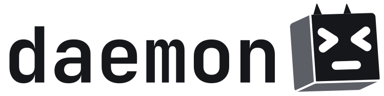
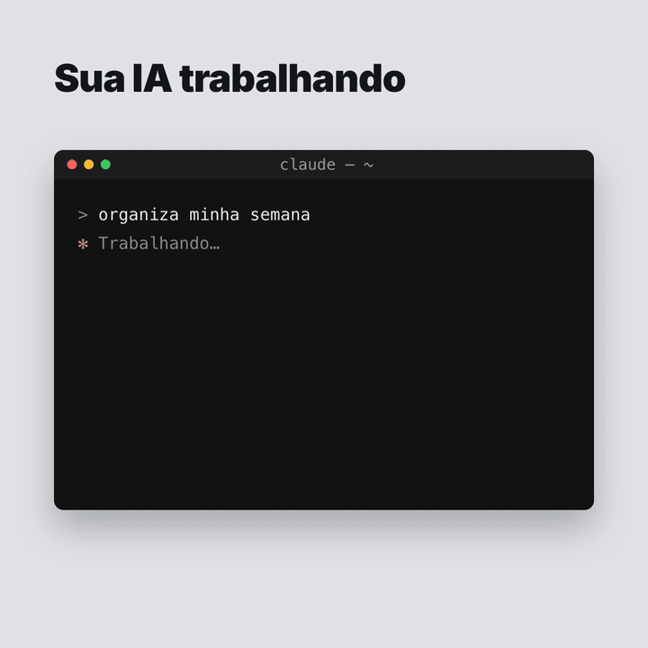

<p align="center">
  <picture>
    <source media="(prefers-color-scheme: dark)" srcset="Resources/Brand/logo-dark.svg">
    
  </picture>
</p>

<p align="center"><b>Your personal AI agent, always alive.</b></p>

<p align="center">
  A native macOS app that keeps your AI CLIs (Claude Code by default) alive in the background,
  in fixed terminal tabs and split windows, with a floating mascot that shows what they are doing.
  Use it as an everyday personal agent, or as the home for your coding CLIs.
</p>

<p align="center">
  
</p>

## What it is

Close a terminal and the AI session inside it dies. Daemon keeps it running: each tab is a real
terminal with a live CLI session, always one shortcut away, even when no window is open.

- **Always-on sessions.** Each tab runs its CLI in a real terminal (PTY). Hide the window and it
  keeps working; reopen the app and each tab resumes the same Claude Code conversation.
- **One session per subject.** Create tabs with the **+** button: Claude Code, Codex, OpenCode,
  Antigravity or any other command. Start a new conversation in a folder or resume an existing
  Claude Code one.
- **Split and detach.** Drag a tab to the edge of a pane to split the window, drag it to another
  pane to move it, or drag it out to give it its own window.
- **Floating mascot.** A small 3D cube, drawn in code, that stays on top of everything. It turns
  to follow your pointer and shows the state of your sessions: ready `> <`, thinking (eyes
  looking around), new reply `^ ^`, needs you (orange glow and a hop with the tab's initial),
  stopped `x x`.
- **Drop files.** Drag files from Finder into a terminal to paste their paths; Claude Code
  attaches images this way.
- **Light.** Native Swift and AppKit. The app itself idles at ~0% CPU; the memory goes to the CLIs.

## Install

**Download:** grab `Daemon.zip` from [Releases](https://github.com/LuizaumSB/daemon/releases),
unzip it and move `Daemon.app` to Applications.

> Daemon is not notarized by Apple (it's a free, open-source side project). The first time, open
> it with **right-click → Open**. If macOS still blocks it, go to **System Settings → Privacy &
> Security** and click **Open Anyway**.

**Build from source** (only the Xcode Command Line Tools are needed: `xcode-select --install`):

```bash
git clone https://github.com/LuizaumSB/daemon.git
cd daemon
./scripts/build-app.sh      # builds build/Daemon.app (release)
open build/Daemon.app
```

Requirements: macOS 13 or later on Apple Silicon, and
[Claude Code](https://docs.claude.com/en/docs/claude-code) installed as `claude`. Other CLIs
(`codex`, `opencode`, `agy`…) work too; the mascot's status comes from Claude Code hooks.

## Shortcuts

| | |
|---|---|
| `⌥ Space` | Show or hide the window, from any app |
| `⌘1` … `⌘9` | Jump to a tab, in any window |
| Drag a tab | To a pane's edge: split. To another pane: move. Outside: new window |
| Right-click a tab | Rename, open in a new window, close |
| Click the mascot | Open the window (or the tab that needs you) |

## How it works

- Each tab runs a login `zsh` in a PTY ([SwiftTerm](https://github.com/migueldeicaza/SwiftTerm))
  with your own shell config, and starts the CLI inside it. When the CLI exits, the shell stays.
- For Claude Code, the app adds [hooks](https://docs.claude.com/en/docs/claude-code/hooks)
  (`SessionStart`, `UserPromptSubmit`, `Stop`, `Notification`) through `--settings`. Each hook
  only writes its JSON to a file in a folder the app watches: no server, no socket.
- To resume, the app reads Claude Code's own transcripts (`~/.claude/projects/…/<id>.jsonl`) to
  find the folder each conversation started in and its title. The conversation itself lives in
  one place only: Claude Code's transcript.
- Windows are a tree of splits (`NSSplitView`); dragging a tab is a native AppKit drag session.
- Settings live in `~/Library/Application Support/Daemon` (`agents.json` holds the tabs).
- Four SwiftPM modules: `DaemonCore` (contracts), `DaemonSession` (PTY, hooks, transcripts),
  `DaemonUI` (mascot, windows, tabs) and `Daemon` (the app).

The mascot's look (camera angles, horns, how much it turns) is in `MascotStyle` at the top of
`Sources/DaemonUI/CubeMascot.swift`. After changing it, `./scripts/make-icon.sh` regenerates the
app icon from the same drawing.

## Privacy

Everything stays on your Mac. The app only reads local files: Claude Code transcripts (to resume
conversations) and its own settings. It makes no network requests; the CLIs you run do whatever
they normally do.

## Roadmap

This is the macOS prototype. Windows and Linux versions are planned for later, in a
cross-platform stack. For now the focus is making this one solid.

## Notes

- Use one conversation in one place: opening the same Claude Code session in Daemon and in
  another terminal at the same time mixes up its transcript.
- Code comments and the UI are in Portuguese (for now).
- Built with [Claude Code](https://docs.claude.com/en/docs/claude-code) as a pair programmer.

## Visual identity

The mark is the cube from the floating mascot, drawn flat in three tones, with horns and the
`> <` face. In the logo it takes the place of a terminal cursor: `daemon` is typed, and the
cursor becomes the mascot. The wordmark is set in [JetBrains Mono](https://www.jetbrains.com/lp/mono/)
Bold (OFL), outlined.

| File | Use |
|---|---|
| [`logo-light.svg`](Resources/Brand/logo-light.svg) / [`logo-dark.svg`](Resources/Brand/logo-dark.svg) | Logo for light / dark backgrounds |
| [`symbol-light.svg`](Resources/Brand/symbol-light.svg) / [`symbol-dark.svg`](Resources/Brand/symbol-dark.svg) | The cube alone |
| [`wordmark-light.svg`](Resources/Brand/wordmark-light.svg) / [`wordmark-dark.svg`](Resources/Brand/wordmark-dark.svg) | The name alone |
| [`icon-dark-mode.png`](Resources/Brand/icon-dark-mode.png) | App icon (made from the mascot by `scripts/make-icon.sh`) |
| [`social-preview.png`](Resources/Brand/social-preview.png) | Link preview (1280×640) |

Colours: ink `#16171B`, cube side `#5D5F66`, accent orange `#FF8A1F` (the "needs you" glow).
The intro video lives in [`video/`](video) as a [HyperFrames](https://github.com/heygen-com/hyperframes) project.

## License

[MIT](LICENSE). Uses [SwiftTerm](https://github.com/migueldeicaza/SwiftTerm) (MIT).

---

### Em português

O Daemon é um app nativo de macOS que mantém os seus CLIs de IA (o Claude Code, por padrão)
sempre vivos em segundo plano, em abas de terminal e janelas divididas, com um mascote flutuante
que mostra o que cada sessão está fazendo. Baixe o `Daemon.zip` em
[Releases](https://github.com/LuizaumSB/daemon/releases) (na primeira vez, botão direito → Abrir)
ou compile com `./scripts/build-app.sh`, só com as Command Line Tools.
