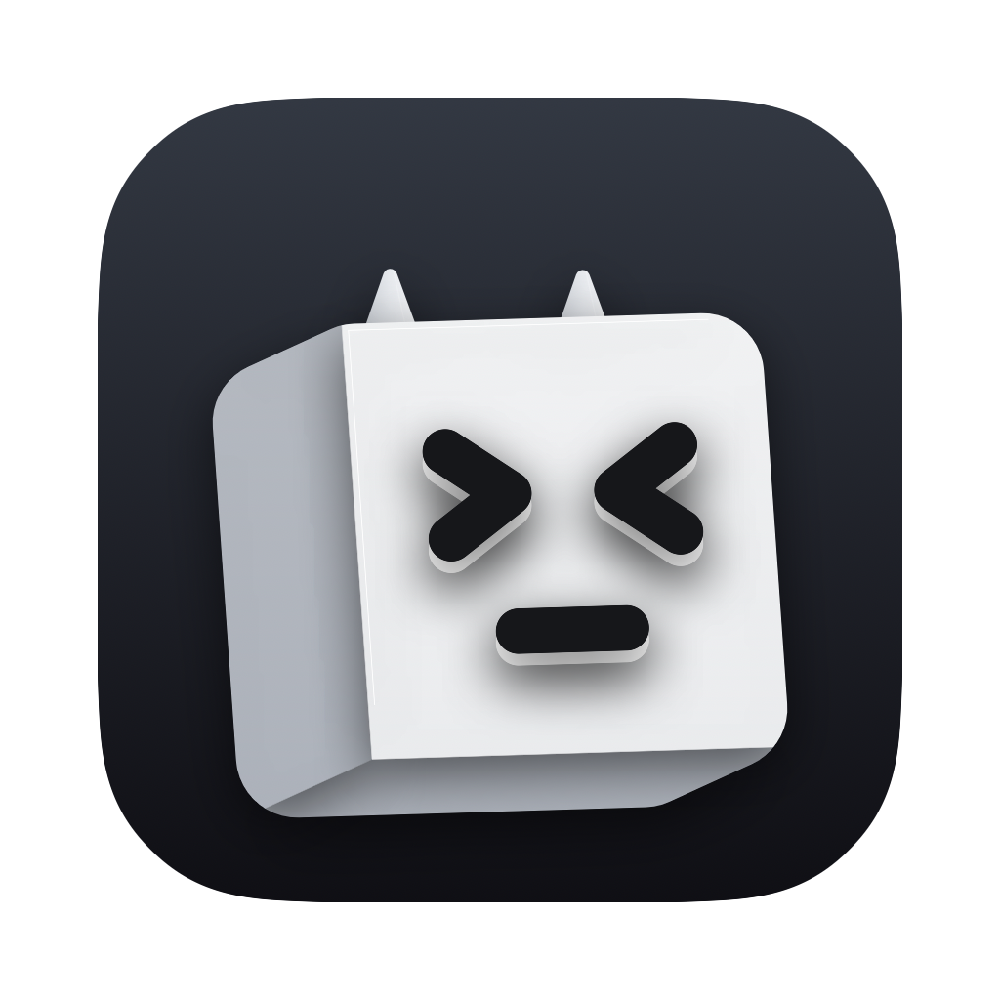

<p align="center">
  
</p>

<h1 align="center">Daemon</h1>

<p align="center">
  A native macOS app that keeps your AI coding CLI (Claude Code by default) always alive in
  the background, with a floating mascot, a compact chat and the full terminal of the same session.
</p>

## Features

- **Always-on sessions.** Each tab is a live CLI session running in a real terminal (PTY).
  Close the window and it keeps working; reopen the app and it resumes the same conversation.
- **Floating mascot.** A small 3D cube, drawn in code, that stays on top of everything and
  shows what the session is doing: ready `> <`, thinking (eyes looking around), new reply
  `^ ^`, needs you (orange glow and a hop), stopped `x x`.
- **Compact chat or full terminal.** Talk to the session in a small chat ("bot") or open the
  full terminal of the same session. Both always show the same conversation.
- **Tabs.** Create tabs with the **+** button: Claude Code, Codex, OpenCode, Antigravity or any
  other command. Start a new conversation in a folder or resume an existing Claude Code one.
- **Keyboard first.** `⌥Space` toggles the panel from anywhere, `⌘1…⌘9` switch tabs, `⌘↩`
  switches between chat and terminal.
- **Light.** Native Swift. The app itself idles at ~0% CPU; most of the memory is the CLIs.

## Requirements

- macOS 13 or later (Apple Silicon).
- [Claude Code](https://docs.claude.com/en/docs/claude-code) installed as `claude` (for the
  chat view). Other CLIs (`codex`, `opencode`, `agy`…) work in terminal mode.
- Swift toolchain: the Xcode **Command Line Tools** are enough (`xcode-select --install`).

## Build and run

```bash
git clone https://github.com/LuizaumSB/daemon.git
cd daemon
./scripts/build-app.sh      # builds build/Daemon.app (release)
open build/Daemon.app
```

For development: `swift build` and `swift run Daemon`.

The build is signed ad hoc, so macOS asks for folder permissions again after each rebuild.
To avoid that, create a local code-signing certificate named **Daemon Local Signing** in
Keychain Access (Certificate Assistant ▸ Create a Certificate… ▸ Self-Signed Root ▸ Code
Signing); `build-app.sh` uses it automatically.

## How it works

- Each tab runs a login `zsh` in a PTY ([SwiftTerm](https://github.com/migueldeicaza/SwiftTerm))
  with your own shell config, and starts the CLI inside it.
- For Claude Code, the app adds [hooks](https://docs.claude.com/en/docs/claude-code/hooks)
  (`SessionStart`, `UserPromptSubmit`, `Stop`, `Notification`) via `--settings`. Each hook only
  writes its JSON to a file; the app watches the folder. No server, no socket.
- The chat view reads the conversation from Claude Code's own transcript
  (`~/.claude/projects/…/<id>.jsonl`), so the chat and the terminal never disagree.
- Settings live in `~/Library/Application Support/Daemon` (`agents.json` for tabs).
- The code is split into four SwiftPM modules: `DaemonCore` (contracts), `DaemonSession`
  (PTY, hooks, transcripts), `DaemonUI` (mascot, panel, tabs) and `Daemon` (the app).

The mascot look (camera angles, horns, light) is in `MascotStyle` at the top of
`Sources/DaemonUI/CubeMascot.swift`. After changing it, `./scripts/make-icon.sh` regenerates
the app icon from the same drawing.

## Privacy

Everything stays on your Mac. The app only reads local files: Claude Code transcripts (to show
the chat and list conversations to resume) and its own settings. It makes no network requests;
the CLIs you run do whatever they normally do.

## Notes

- Use one conversation in one place: opening the same Claude Code session in Daemon and in
  another terminal at the same time mixes up its transcript.
- Code comments and the UI are in Portuguese (for now).

## Roadmap

Daemon is a **macOS prototype**. Versions for **Windows and Linux** are planned for the
future, probably rewritten in another language/stack better suited to cross-platform desktop
apps. For now, the focus is to keep improving this prototype on macOS.

## License

[MIT](LICENSE). Uses [SwiftTerm](https://github.com/migueldeicaza/SwiftTerm) (MIT).

---

### Em português

O Daemon é um app nativo de macOS que mantém o seu CLI de IA (o Claude Code, por padrão)
sempre vivo em segundo plano, com um mascote flutuante, um chat compacto e o terminal completo
da mesma sessão, em abas. Para compilar, só as Command Line Tools: `./scripts/build-app.sh`.

Este é um **protótipo para macOS**. No futuro, a ideia é ter versões para **Windows e Linux**,
provavelmente em outra linguagem, mais adequada a apps multiplataforma. Por enquanto, o foco é
melhorar este protótipo.
